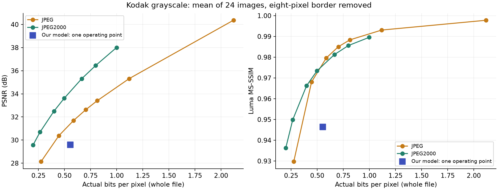
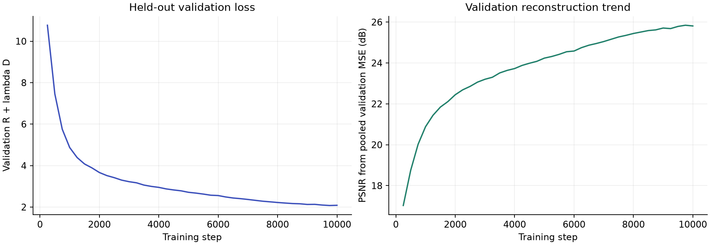
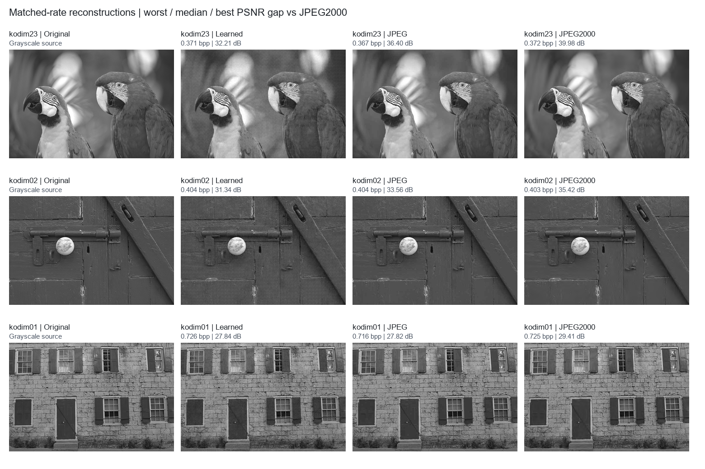
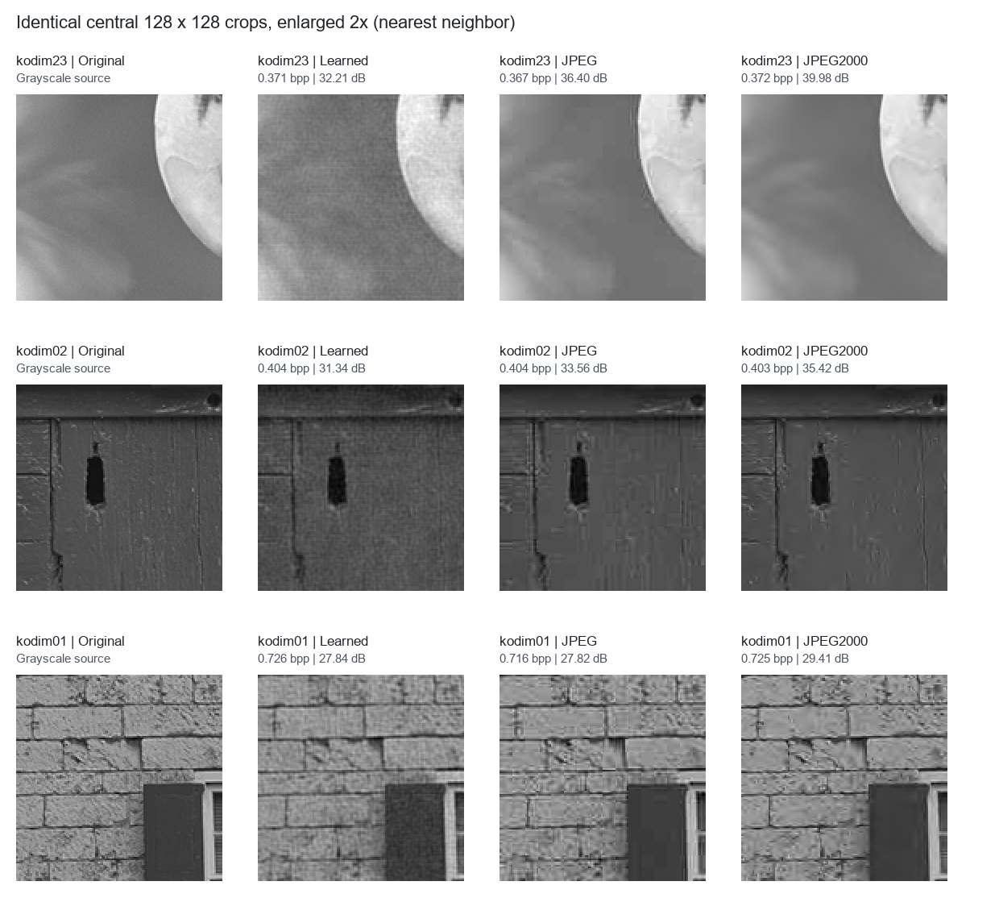

# First Kodak evaluation — 2026-11-02

All 24 images evaluated; all 24 files decoded exactly to the rounded neural
forward-pass reconstruction. Best checkpoint: step 9,750, selected using held-out
Imagenette validation; training ran 10,000 steps. Grayscale, 128 channels, lambda 512.

## Average results

| Method | Actual bpp | Mean PSNR (dB) | Mean luma MS-SSIM |
| --- | ---: | ---: | ---: |
| Our learned model (reference coder) | 0.5543 | 29.60 | 0.9464 |
| JPEG, matched per image | 0.5543 | 31.55 | 0.9784 |
| JPEG2000, matched per image | 0.5528 | 34.04 | 0.9783 |

- Against JPEG, matched per image: mean PSNR difference **-1.95 dB**; learned model wins PSNR on 1/24 and MS-SSIM on 0/24 images. Mean absolute rate mismatch 0.70%, maximum 1.42%.
- Against JPEG2000, matched per image: mean PSNR difference **-4.45 dB**; learned model wins PSNR on 0/24 and MS-SSIM on 1/24 images. Mean absolute rate mismatch 0.41%, maximum 1.38%.

The mean estimated neural rate is 0.5700 bpp;
actual payload is 0.5484 bpp and container overhead
is 0.0060 bpp. Whole-file rate includes the custom header.

## Figures

The displayed images are selected by the worst, median and best learned-minus-
JPEG2000 PSNR gap; they are not handpicked successes. Full-resolution reconstructions, matched classical files and learned bitstreams remain local under the training run folder and are excluded from this Git snapshot.

## Interpretation limits

- This is one operating point, so no learned rate-distortion curve or BD-rate
  claim is possible. The classical curves average fixed quality/ratio settings.
- Matched comparisons use real encoded files at the closest searched size;
  rates are approximate, with their mismatches reported above.
- Training used 4,726 filtered, full-resolution Imagenette images (ten classes),
  not the paper's ImageNet subset. The model is only an initial 10,000-step run.
- The arithmetic coder is our adaptive reference implementation, not original
  CABAC. This is not a historical-performance reproduction claim.
- Eight pixels are removed from each Kodak edge. All methods use the same
  grayscale crop. Classical codecs consume rounded 8-bit grayscale; errors are
  measured against original floating-point luma. Neural metrics use raw floating
  outputs, while PNG previews are clipped and rounded.
- MS-SSIM uses pytorch-msssim; parity with the legacy implementation is unverified.
- Table PSNR is the mean of per-image PSNRs. Validation trend uses PSNR derived
  from mean validation MSE, which is a different aggregation.

Machine-readable results: `per_image.csv`, `summary.json`, `analysis.json`,
`protocol.json`. The training run, manifests and dataset hashes remain alongside
the documented experiment. Test images did not select the checkpoint.
